<picture>
  <source media="(prefers-color-scheme: dark)" srcset="assets/header-dark.svg">
  
</picture>

I'm a software architect. For the last six-plus years I've designed and built systems for financial markets, fitness and health: the kind of software where data has to be right and stay right.

Lately most of my free time goes into AI and LLMs, open source, tools for developers, and simulations. The village above is a small nod to that last one: it's generated from a fixed seed by [`assets/generate.py`](assets/generate.py), so it comes out the same every time.

### What I'm building

**[Waymark](https://github.com/AlanEdward19/waymark)**: ask "why is it built this way?" and get the PR, the issue and the commit that answer it.
An open-source, self-hosted context layer that turns repos, trackers, docs and chats into one searchable, source-linked memory for a team and its AI coding agents. It ships an MCP server and works with Claude Code and Cursor. TypeScript, SQLite, MIT.

**[Living World](https://github.com/AlanEdward19/LivingWorld)**: a world that keeps going without a player.
A persistent simulator of societies, populations and individuals. Families, economy, births, deaths and skills are all resolved by a deterministic engine: same seed plus same ticks gives the same world. An LLM only comes in later, to interpret and talk, never as the source of truth. The first milestone is 100 NPCs in a medieval village for 100 years, with no LLM at all. .NET 10, C#, SQLite.

**ShapeUp**: a social network for people who train.
It connects people to personal trainers and nutritionists, with workout and nutrition tracking and a marketplace for professional services. I'm now building v2, with a web app and a mobile app.

### Day to day

C# and .NET most of all, plus TypeScript, Python and some Go. Azure, Docker and Kubernetes. PostgreSQL, SQL Server, SQLite and Redis. React and Angular on the front end.

### Activity

<picture>
  <source media="(prefers-color-scheme: dark)" srcset="assets/stats-dark.svg">
  
</picture>

### Reach me

[LinkedIn](https://linkedin.com/in/alan-e-b74831134) · [Instagram](https://instagram.com/_themussa)
